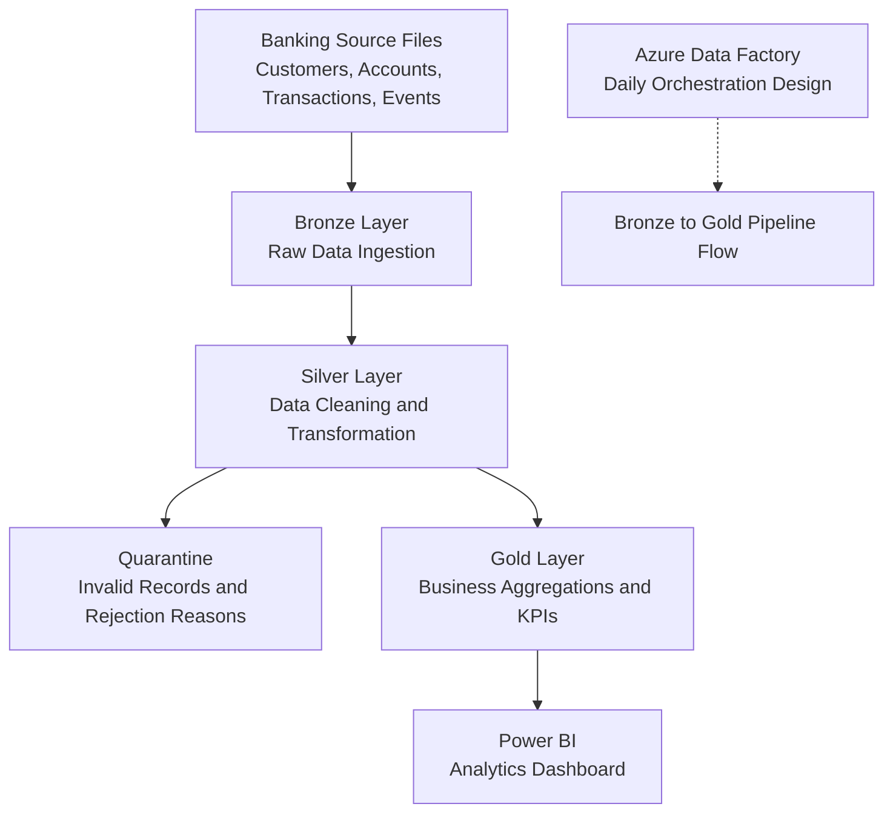

# Banking Transaction Data Engineering Platform — Architecture

## Technology Stack

- Databricks Free Edition
- PySpark and Spark SQL
- Delta Lake
- Azure Data Factory
- Power BI

## Implementation Note

The Databricks data processing and Azure Data Factory orchestration were implemented separately. The ADF pipeline currently uses placeholder Wait activities and is not natively integrated with Databricks.
