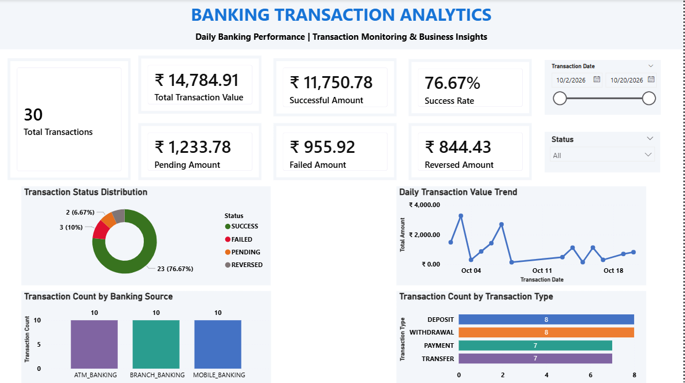
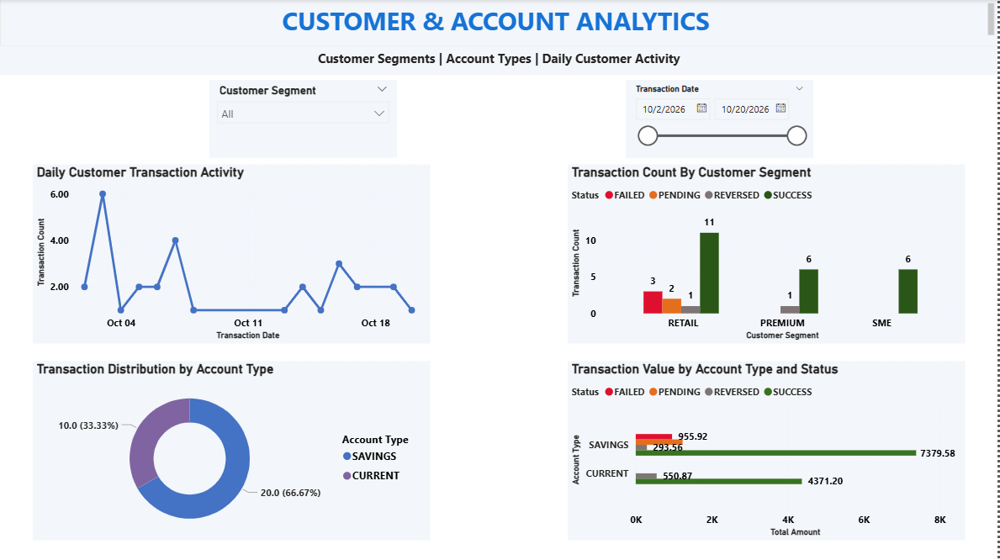

# Power BI Dashboard — Banking Transaction Analytics

## Overview

This Power BI dashboard provides business insights into banking transactions using Gold-layer analytical datasets created in Databricks.

The dashboard helps monitor transaction performance, banking sources, customer activity, account types, and transaction statuses.

## Dashboard Pages

### 1. Banking Overview

Provides a high-level view of banking performance through:
- Total transactions
- Total transaction amount
- Successful, failed, pending and reversed amounts
- Transaction success rate
- Daily transaction value trend
- Transaction status distribution
- Transaction count by banking source
- Transaction count by transaction type

### 2. Customer and Account Analysis

Provides insights into customer segments and account activity:
- Daily customer transaction activity
- Transaction count by customer segment
- Transaction distribution by account type
- Transaction value by account type and status

### 3. Transaction Analysis

Provides a detailed analytical view of transaction patterns:
- Transaction status distribution
- Transaction count by transaction type and status
- Transaction count by banking source and status
- Daily transaction value trend

## Data Sources

The dashboard uses the following Gold-layer tables from Databricks:

1. `gold_daily_business_kpis`
2. `gold_daily_transaction_summary`
3. `gold_daily_transaction_summary_by_source`
4. `gold_daily_customer_summary`
5. `gold_daily_segment_summary`
6. `gold_daily_account_type_summary`
7. `gold_daily_transaction_type_summary`

## Tools and Technologies

- Microsoft Power BI Desktop
- Databricks Free Edition
- Databricks SQL Warehouse
- DAX
- Power Query

## Key Project Results

- 30 banking transactions processed
- Total transaction value: ₹14,784.91
- Successful transactions: 23
- Failed transactions: 3
- Pending transactions: 2
- Reversed transactions: 2
- Success rate: 76.67%

## Dashboard Features

- Interactive date and category slicers
- KPI cards
- Trend analysis
- Transaction status monitoring
- Customer and account analysis
- Banking source comparison
